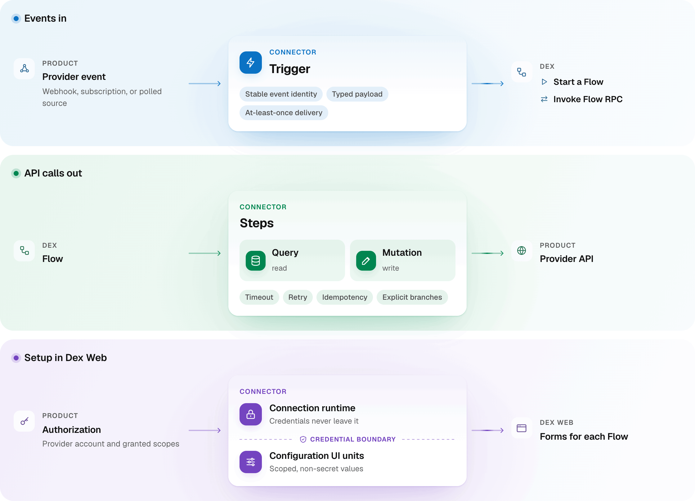
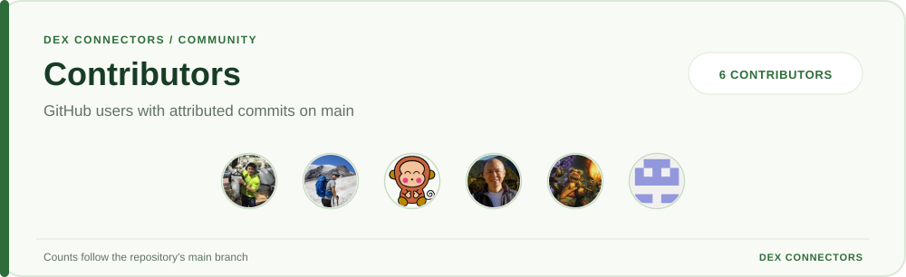

<a href="https://connectors.superdurable.io/"></a>

# [Dex Connectors](https://connectors.superdurable.io/)

**Open-source connectors for [Dex](https://github.com/superdurable/dex) applications.** Add a connector to a Flow to call a provider's API as typed Steps, or start Flows and call Flow RPCs from its events; Dex handles retries, idempotency, and recovery. Applications can use released connectors from Go, Python, and TypeScript.

[Browse connectors](https://connectors.superdurable.io/) · [Connector concepts](https://docs.superdurable.io/concepts/connector/) · [Build with AI](https://docs.superdurable.io/build-with-ai/dex-developer-skill/) · [Dex docs](https://docs.superdurable.io/)

## 🧠 Concepts

<a href="https://connectors.superdurable.io/#/what-is-dex-connectors">
  <picture>
    <source media="(prefers-color-scheme: dark)" srcset="docs/assets/connector-map-dark.gif" />
    
  </picture>
</a>

- ⚡ **Trigger** receives provider events and, for each one, starts a Flow or calls a Flow RPC. Delivery is at least once.
- 🔍 **Query** is an operation that reads provider state in a Step.
- ✏️ **Mutation** is an operation that changes provider state in a Step and sends an idempotency key. When the outcome is unknown, it selects the `uncertain` branch instead of sending again.
- 🔑 **Connection** is the named provider account that a Step or Trigger uses. Its credentials never enter Flow state.
- 🧩 **Configuration UI unit** is a connector-owned control that Dex Web combines into the settings form for a Step or Trigger binding.

## 🤖 Build with AI

Dex Skills teach a coding agent, such as Codex, Claude Code, or Cursor, to build Dex applications with released connectors. In Claude Code:

```sh
claude plugin marketplace add superdurable/dex-skills
claude plugin install superdurable-dex@superdurable
```

```text
/superdurable-dex:dex-app-builder Design and build an event-registration application.
```

[Dex App Builder](https://docs.superdurable.io/build-with-ai/dex-developer-skill/dex-app-builder/) builds a complete application; [Dex SDK](https://docs.superdurable.io/build-with-ai/dex-developer-skill/dex-sdk/) handles focused SDK work in any supported language. Other hosts: [Install and use Dex Skills](https://docs.superdurable.io/build-with-ai/dex-developer-skill/).

## 👀 Example

Install a connector package, open its named connection, and add an operation Step to a Flow. Gmail in Python:

```python
# pip install dex-connector-google-gmail
from dex_connectors.sdk.projectconfig import load_from_environment
from dex_connectors.google_gmail import GetMessageInput, new_get_message_step, new_project_connection

async def main():
    project = await load_from_environment()
    connection = new_project_connection(project, "gmail-inbox")
    ...

# In your dex.Flow:
read = new_get_message_step(
    step_type="ReadReceivedEmail", step_input_type=..., annotations=...,
    connection=connection, connection_name="gmail-inbox",
    map_to_operation_input=lambda value: GetMessageInput(value.message_id),
    read=message_read,  # happy-path branch -> next Step
)
```

The same in TypeScript:

```ts
// npm install @superdurable/connector-google-gmail @superdurable/dex
import { loadFromEnvironment } from '@superdurable/connectors-sdk/projectconfig';
import { newGetMessageStep, newProjectConnection, type GetMessageInput } from '@superdurable/connector-google-gmail';

const project = await loadFromEnvironment();
const connection = newProjectConnection(project, 'gmail-inbox');

const readStep = newGetMessageStep<GetMessageInput>({
  stepType: 'ReadGmailMessage', connectionName: 'gmail-inbox', connection,
  annotations: { /* ... */ }, mapToOperationInput: input => input,
  read: doneStep, // happy-path branch -> next Step
});
```

A Mutation Step has the same shape, for example `new_reply_to_message_step(..., sent=...)`. Runnable examples: [Python](connectors/google/gmail/python/examples/thread_reply/flow.py) and [TypeScript](connectors/google/gmail/typescript/examples/gmail-flow/). The [directory](https://connectors.superdurable.io/) shows which languages each connector supports. Python and TypeScript packages implement operations, and TypeScript packages can also implement Triggers, such as [Slack](connectors/slack/typescript/examples/thread-approval/).

## 📚 Learn more

- [Configure connections in Dex Web](https://docs.superdurable.io/reference/web/local-connector-setup/) for local development.
- [Connectors as agent tools](https://docs.superdurable.io/agent-frameworks/connectors-as-tools/).
- [Slack thread approval walkthrough](connectors/slack/go/examples/thread-approval/README.md): a Go example with Triggers, a Flow RPC, and configuration UI units.

## 🛠️ Contributing

Add a connector, operation, Trigger, or configuration UI unit with the [Dex Connector Contributor](https://docs.superdurable.io/build-with-ai/dex-developer-skill/dex-connector-contributor/) skill:

```text
/superdurable-dex:dex-connector-contributor Add <XYZ> to Dex official connector library
```

The skill is a thin bootstrap: it finds or creates your fork and loads this repository's rules. After checkout, [AGENTS.md](AGENTS.md), the [architecture](docs/architecture.md), [connector contract](docs/connector-contract.md), [manifest guide](docs/manifest-authoring.md), [configuration guidance](docs/configuration-guidance.md), [acceptance criteria](docs/acceptance.md), and [versioning and releases](docs/versioning-and-releases.md) are the authoritative contribution workflow.

<details>
<summary>OAuth authorization evidence</summary>

When a contribution adds a connector or operation with `spec.auth.type: oauth2`, open the pull request early rather than waiting for live authorization testing. Authors are then encouraged to test the real provider application, API, or scope configuration and optionally attach a screenshot to the pull request description. This applies to OAuth 2.0 and OpenID Connect, not API keys or other static credentials. Redact secrets and personal data, never commit the screenshot, and say plainly if live testing is incomplete. Missing evidence must not block early connector sharing or review.

</details>

### Contributors

<a href="https://github.com/superdurable/dex-connectors-library/graphs/contributors">
  <picture>
    <source media="(prefers-color-scheme: dark)" srcset="https://raw.githubusercontent.com/superdurable/dex-connectors-library/readme-assets/contributors-dark.svg" />
    
  </picture>
</a>
